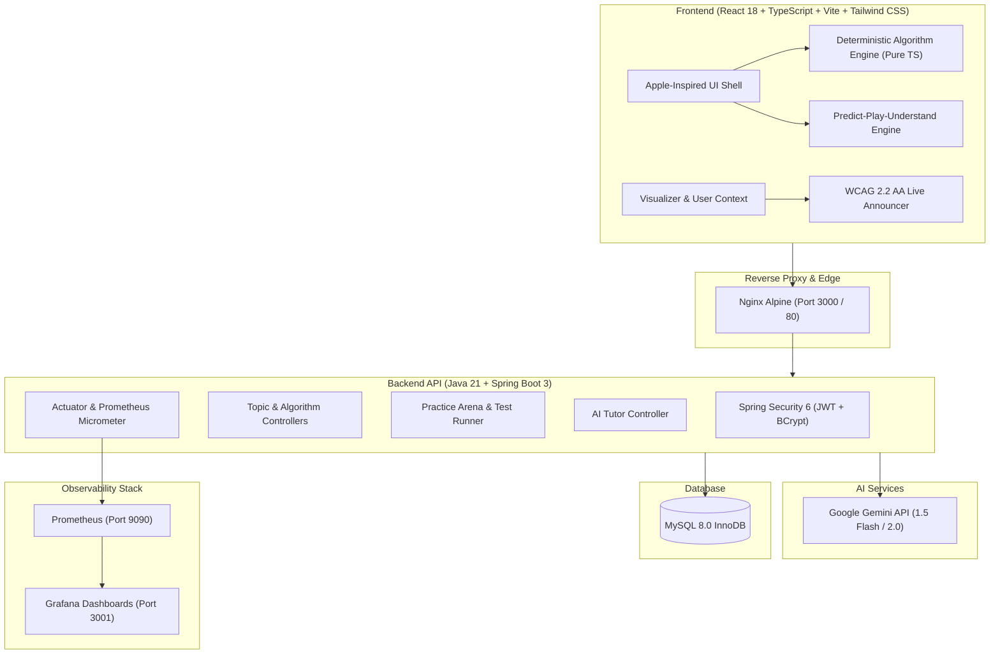
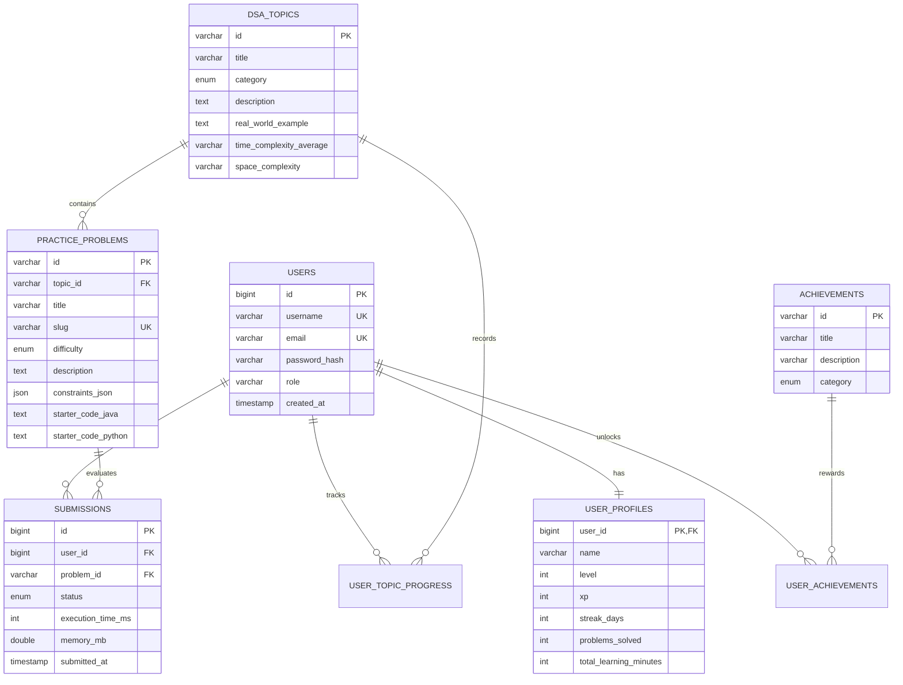

# AlgoPlay — Interactive DSA Learning Platform

> A production-quality, interactive web application engineered to help students master Data Structures & Algorithms through interactive visualizations, deterministic step-by-step execution, gamification, and AI tutoring.

---

## 1. System Architecture



---

## 2. Folder Structure

```
algoplay/
├── .github/
│   └── workflows/
│       └── ci.yml                      # GitHub Actions: Lint, Vitest, Maven tests, Build
├── frontend/
│   ├── src/
│   │   ├── components/
│   │   │   ├── common/                 # Navbar, Footer, ThemeToggle, Shortcuts, LiveAnnouncer
│   │   │   ├── visualizer/             # Canvas, ControlsBar, VariableTable, SynchronizedCodeViewer
│   │   │   │                           # PredictPlayUnderstandModal, ComplexityCard, CustomInputModal
│   │   │   ├── dashboard/              # Personalized Dashboard, Streaks, Challenges, Badges
│   │   │   ├── learn/                  # Full DSA syllabus catalog with difficulty tiers
│   │   │   ├── practice/               # Coding arena, test runner, starter code
│   │   │   ├── ai-tutor/               # Gemini chat interface, dry-run simulation
│   │   │   └── profile/                # Progress, weekly consistency calendar, achievements
│   │   ├── context/                    # ThemeContext, UserContext, VisualizerContext
│   │   ├── engine/
│   │   │   ├── core/                   # AlgorithmEngine class & Registry
│   │   │   └── algorithms/             # Binary Search, Linear Search, Bubble, Selection,
│   │   │                               # Insertion, Merge, Quick Sort, Two Pointers, Sliding Window,
│   │   │                               # Stack, Queue, etc.
│   │   ├── types/                      # TypeScript domain types & interfaces
│   │   ├── tests/                      # Vitest unit test suite
│   │   ├── App.tsx                     # Master Application Shell
│   │   └── main.tsx
│   ├── Dockerfile
│   ├── nginx.conf
│   └── vite.config.ts
├── backend/
│   ├── src/
│   │   ├── main/
│   │   │   ├── java/com/algoplay/
│   │   │   │   ├── config/             # SecurityConfig (JWT, CORS), OpenTelemetry
│   │   │   │   ├── controller/         # Auth, Topic, Practice, AiTutorController
│   │   │   │   └── model/              # JPA Entities (User, UserProfile, DsaTopic, etc.)
│   │   │   └── resources/
│   │   │       ├── application.yml     # Configuration & Prometheus settings
│   │   │       └── schema.sql          # MySQL DDL relational schema with indexes
│   └── pom.xml
├── docker-compose.yml                  # MySQL 8, Backend, Frontend, Prometheus, Grafana
├── prometheus.yml
└── README.md
```

---

## 3. Database Design



---

## 4. API Endpoint Design

| Method | Endpoint | Description | Auth Required |
|---|---|---|---|
| `POST` | `/api/auth/register` | Register new student account | Public |
| `POST` | `/api/auth/login` | Authenticate and obtain JWT token | Public |
| `GET` | `/api/topics` | List all DSA topics with metadata | Public |
| `GET` | `/api/topics/{id}` | Retrieve topic details, dry run, and code | Public |
| `POST` | `/api/practice/submit` | Execute code in isolated test runner | User (JWT) |
| `POST` | `/api/ai-tutor/explain` | Socratic algorithmic tutoring via Gemini | Public / User |
| `GET` | `/actuator/prometheus` | Prometheus application metrics | Monitoring |
| `GET` | `/actuator/health` | Health check endpoint | Public |

---

## 5. UI Page Structure

Inspired by **Apple’s design philosophy** (minimalist aesthetic, SF typography, soft borders, frosted glass blur, intuitive spatial transitions):
1. **Dashboard**: Personalized learning metrics (streak, problems solved, study time, XP progress bar, daily challenge, achievements).
2. **Learn DSA**: Comprehensive categorized syllabus with Beginner, Intermediate, and Advanced tiers, complexity tags, and direct visualizer launcher.
3. **Interactive Visualizer**: The centerpiece execution canvas, synchronized Java & Python viewer with line highlighting, live variable table, speed slider, and Predict Mode.
4. **Practice Arena**: Code problem solving with sample cases, test runner, constraints, hints, and language toggle.
5. **AI Tutor**: Real-time Gemini-powered DSA tutoring with dry runs, complexity explanations, and Socratic hints.
6. **Progress & Profile**: Weekly consistency calendar, XP breakdown, and unlocked badges.

---

## 6. How to Run Locally

### Frontend (Quick Start)
```bash
cd frontend
npm install
npm run dev
```
Open [http://localhost:3000](http://localhost:3000) in your browser.

### Run Unit Tests
```bash
cd frontend
npm run test
```

### Full Multi-Container Docker Stack
```bash
docker compose up --build
```
- Frontend: `http://localhost:3000`
- Backend API: `http://localhost:8080`
- Prometheus: `http://localhost:9090`
- Grafana: `http://localhost:3001`
- MySQL: `localhost:3306`

---

## 7. Accessibility (WCAG 2.2 AA)

- **Semantic HTML**: Proper `main`, `header`, `nav`, `footer`, `role="status"` and `role="dialog"`.
- **Keyboard Navigation**: Full visualizer keyboard controls (`Space`/`K` to play/pause, `→`/`L` to step forward, `←`/`J` to step back, `R` to reset, `P` to toggle predict mode).
- **Screen Reader Support**: Dedicated live region (`aria-live="polite"`) announcing each algorithmic change and step description.
- **Color Contrast**: Complies with 4.5:1 minimum contrast ratio for text and active UI elements across both Light and Dark themes.
- **Non-Color Indicators**: Algorithm states use borders, badges, scale transforms, and textual labels (e.g., `[low]`, `[mid]`, `[high]`), not color alone.
